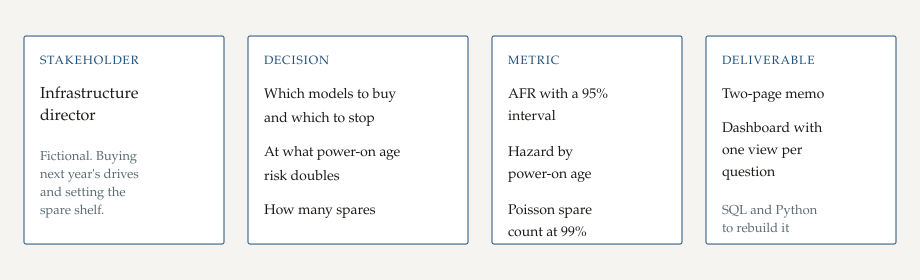

# Phase 1: Ask

## Purpose

Turn a budget request into three questions the drive file can answer, and write down what the memo will not claim.

## What this phase produces

This note: the stakeholder, the questions, the success criteria, and the boundary. The framing diagram is [problem_framing.svg](problem_framing.svg).

## The work

The stakeholder is an infrastructure director. The role, the site, and the budget cycle are fictional. She is about to place next year's capacity order and set the spare shelf. She has been choosing models without a failure-rate screen.

Primary questions:

1. Which drive models should the 2027 buy standardize on, and which should stop?
2. At what power-on age does failure risk rise sharply?
3. How many spares cover replacement lead time without a capacity shortfall?

Success criteria: the first paragraph of the memo names a standard model, a stop list, an age, and a spare count, each with the number it rests on. A reader can see the sample size and the interval, and can tell a planning assumption from a measurement.

Out of scope:

- A cause for why one model fails more often. Backblaze chooses which model goes into which pod. This file does not contain that assignment.
- A claim about another company's rooms, temperature, vibration, or duty cycle.
- Aircraft, vehicle, or military parts. These are data-center hard drives.
- SSD buying. Solid-state drives are counted and then set aside.
- Vendor quotes. The prices used later are a planning schedule.

## Check

Someone else can read this file and say what the memo will deliver and what it will refuse to claim. The three questions are the three headings on the dashboard.
