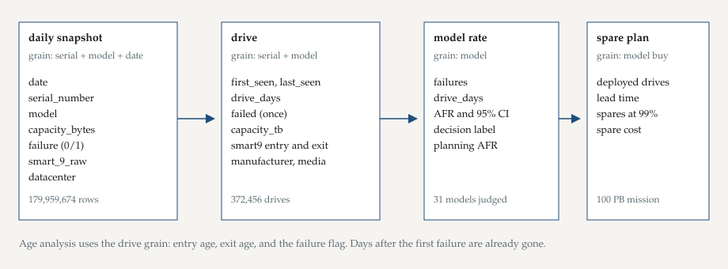

# Phase 2: Prepare

## Purpose

Know the file, the license, and the grain before any row is dropped.

## What this phase produces

Source, download date, grain, dictionary, and the bias that limits every later sentence. The sketch is [data_model.svg](data_model.svg). Raw zips land in `data/raw/` and are never edited. They are gitignored.

## The work

**Source.** [Backblaze Drive Stats](https://www.backblaze.com/cloud-storage/resources/hard-drive-test-data), quarterly zip files `data_Q1_2025.zip` through `data_Q2_2026.zip` from `https://f001.backblazeb2.com/file/Backblaze-Hard-Drive-Data/`. Downloaded 23 October 2026. Q2 2026 was the latest quarter published on that date. The window was chosen before any model ranking: the most recent six published quarters, so the buy list is about drives Backblaze was still running.

**Terms.** The files are used under Backblaze's terms. This repository cites the source and does not redistribute the raw zips. The published schema files in `data/reference/` are kept because they document the column list, and they are not the drive rows.

**Unit of analysis.** One row in a daily file is one drive on one day. The reliability question is about a drive, so the process step collapses those days. Mixing the two grains would count a long-lived drive as many failures of evidence and a failed drive as one bad day.

**What was on disk.** Six zip files, 546 daily CSVs (90, 91, 92, 92, 90, 91 files by quarter). Every file in this window has the same 197-column header, including `datacenter` and `smart_9_raw`. The published schema file, marked "Last Updated Q2 2024", spells `smart_211_normailized` and `smart_212_normailized`. The files spell those unused columns `normalized`.

**Fields used.** `date`, `serial_number`, `model`, `capacity_bytes`, `failure`, `smart_9_raw`, `datacenter`. `failure` is Backblaze's operational-removal flag, 0 or 1. `smart_9_raw` is power-on time. The other SMART columns are not used.

**Known bias.** The fleet is the drives Backblaze bought, installed, and kept reporting. A model that looks reliable here has survived Backblaze's procurement and their rooms. A model that looks bad may be bad hardware, a bad batch, a hard workload, or a building. Datacenter is on every drive in this extract, which makes the mix visible and does not remove it. Drives that leave without `failure = 1` are censored. That is right if they were migrated and wrong if a death was never flagged.

## Check

The unit of analysis is one drive-day in the raw file and one drive after the collapse. The biggest bias is that model and location and workload are assigned together, so a rate difference is an association.
