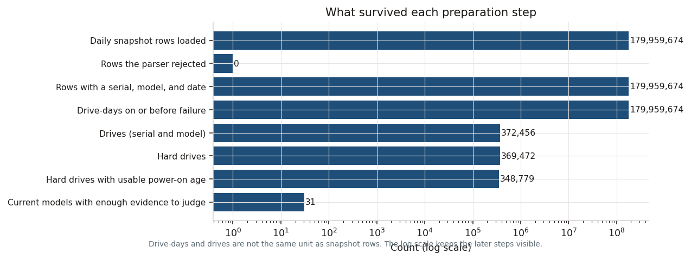

# Phase 3: Process

## Purpose

Collapse the daily files to one row per drive, and write down every decision that changes a count.

## What this phase produces

`sql/01_collapse_quarter.sql`, `sql/02_combine_drives.sql`, `sql/03_classify_and_afr.sql`, run by `analysis/process_data.py`. The quality log below is the judgment. The funnel is `docs/figures/preparation_funnel.png`. Deleting `data/processed/` and rerunning the script rebuilds it from `data/raw/`.

## The work

Each quarter is read one zip at a time. CSV cells come in as text so a bad unused SMART value cannot drop the row, and the eight fields above are cast. Files that share a header are stacked. Rejected rows are counted. Within a quarter, the grain becomes serial + model + date, then serial + model. Drive-days stop at the first `failure = 1`. SMART 9 at entry is the value on the first day. SMART 9 at exit is the value on the last day at or before failure. Model strings are uppercased and internal whitespace is collapsed. The six quarter tables are then one row per serial and model across the window: drive-days sum, failure is the max, and a failure keeps the exit age from the failure date.

Quarters, all media:

| Quarter | Files | Drives | Failures | Drive-days |
| --- | ---: | ---: | ---: | ---: |
| 2025 Q1 | 90 | 318,426 | 1,067 | 27,799,986 |
| 2025 Q2 | 91 | 322,499 | 1,061 | 28,808,042 |
| 2025 Q3 | 92 | 332,915 | 1,254 | 29,844,451 |
| 2025 Q4 | 92 | 341,664 | 945 | 30,941,708 |
| 2026 Q1 | 90 | 351,095 | 1,030 | 30,597,484 |
| 2026 Q2 | 91 | 359,101 | 1,522 | 31,968,003 |

Combined: 372,456 drives, 179,959,674 drive-days, 6,861 failures. Hard drives 369,472. SSDs 2,984, with no failures in this window. Unclassified hard-drive manufacturers: 0. The pipeline stops if that unclassified count exceeds 1,000.

Backblaze's published Q2 2026 snapshot, read from the source page the same day, is 354,415 drives, 1,498 failures, 31,553,350 drive-days, AFR 1.73%. This extract's all-media Q2 is 4,686 drives, 24 failures, and 414,653 drive-days higher. The pipeline was not retuned to force a match. Hard-drive-only Q2, which is the population in the memo, is 356,189 drives, 1,522 failures, 31,705,919 drive-days, AFR 1.75%.

### Quality log

| # | Issue found | How detected | Decision | Rows affected | Impact |
| --- | --- | --- | --- | ---: | --- |
| 1 | Schema spelling and column lists can change between quarters | Header of every CSV, then the published schema file | All six quarters share one 197-column header, so this window needed no alignment. The loader still projects by name. The `normailized` / `normalized` spelling is on unused columns. | 179,959,674 | None for these rates |
| 2 | Parser could not read a row | DuckDB `reject_errors` | Counted and left out | 0 | None here |
| 3 | Row has no serial, model, or date | Null and blank check after casting | Dropped before the collapse | 0 | None here |
| 4 | Two snapshots for one drive on one day | Count of serial-model-date groups | Collapsed to one day | 0 | None here |
| 5 | Drive still appears after its failure date | Dates after the first `failure = 1` | Those days leave the denominator and the exit age | 0 | None here |
| 6 | Capacity missing, zero, or negative | `capacity_bytes` null or ≤ 0 | Drive-days still count. Capacity is the largest positive value seen. | 0 | None here |
| 7 | Positive capacities for one drive disagree by more than 5% | Min and max within serial and model | Keep the max and count the drive | 0 | None here |
| 8 | SMART 9 null or negative | Null and sign check | Ignored for age. The drive stays in the AFR. | 236,748 | Medium for the age curve only. About 0.13% of snapshot rows. |
| 9 | Failure flag is neither 0 nor 1 | Value check | Treated as not a failure | 0 | None here |
| 10 | HDD manufacturer the lookup does not know | `manufacturer = Other` after the SQL map | Left as Other. More than 1,000 such drives would stop the recommendation. | 0 | None here |

Manufacturer rules are name prefixes: Seagate `ST`, HGST `HGST`/`HUH`/`HMS`/`HUS`/`HDN`, WDC `WUH`/`WUS`/`WDC`/`WD`, Toshiba `TOSHIBA`/`MG`/`HDWG`/`HDWE`/`DT`. SSD is a name match (`SSD`, Samsung, Intel, Micron, and the other tokens in `sql/03_classify_and_afr.sql`). One model was stored with and without a prefix: 585 drives labeled `WUH721816ALE6L4` are the same model as `WDC WUH721816ALE6L4`. They are merged before any rate is judged. Left apart, the 585-drive slice looked like its own failure rate.

### Metric definitions

| Metric | Definition | Numerator | Denominator | Notes |
| --- | --- | --- | --- | --- |
| Annualized failure rate | Backblaze's AFR | Drives with `failure = 1` | Drive-days on or before the failure date | AFR = failures / drive-days × 365. The 95% interval is a Garwood Poisson interval. |
| Eligible model | A current model with enough time to judge | — | — | HDD, still present in 2026 Q2, at least 200 drives, at least 100,000 drive-days, at least 8 TB. |
| Stop | Worse than the fleet, with the interval clearing the fleet | — | — | Lower 95% bound above the fleet HDD AFR. |
| Approved | A buy candidate | — | — | Not a stop, and the point AFR is at most 1.25 times the fleet AFR. |
| Power-on age | SMART 9 converted to years | — | — | Per model, the median positive entry value chooses the unit. Hours if the median is at most 150,000. Minutes if at least 500,000. Seconds if at least 10,000,000. Anything between those cutoffs is unused. In this window every usable model was already in hours. |
| Age-ok drive | The counter tells a coherent story | — | — | Entry &gt; 0, exit &gt; entry, both at most 15 years, the gain is at most calendar years + 0.5, and the drive was seen at least 2 days. 348,779 of 369,472 hard drives (94.4%). |
| Planning AFR | The rate used for spares | Failures in the first power-on year, if that hazard is higher and estimable | Exposure while age is under 1, in drive-years | Used only when that band has at least 200 drive-years and 5 failures and the hazard exceeds the all-age AFR. Otherwise the all-age AFR. |
| Spares | Smallest integer whose Poisson CDF is at least 99% | — | — | Mean = deployed drives × planning AFR × 42/365. Each fleet size is recomputed. The quantile is not linear in the fleet. |

Rules in `analysis/assumptions.py` were fixed before model rankings, except the two stability checks named in Phase 4. Those were added after the cost screen and are labeled as such.

Funnel: 179,959,674 snapshot rows loaded, 0 rejected, 179,959,674 drive-days, 372,456 drives, 369,472 hard drives, 348,779 with usable power-on age, 31 current models with enough evidence to judge.

## Check

`data/processed/` can be deleted and rebuilt from `data/raw/` with `python3 analysis/process_data.py`. The quality log has a row count on every issue, including the zeros.
