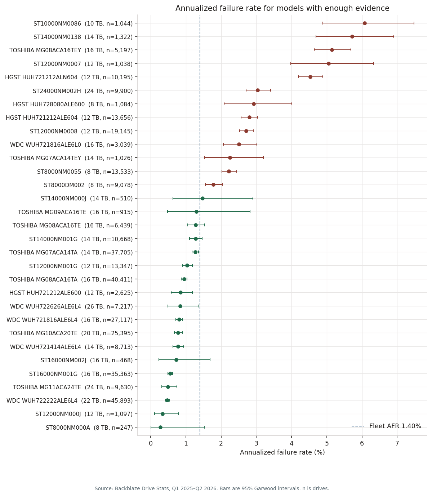

# Phase 4: Analyze

## Purpose

Answer the three questions with the smallest method that respects censoring, and say what would make each answer wrong.

## What this phase produces

`analysis/analyze.py`, `analysis/metrics.py`, `analysis/survival.py`, and the tables in `reports/`. The chart with intervals and sample sizes is `docs/figures/afr_by_model.png`.

## The work

**Rates, first.** The fleet hard-drive AFR for 1 January 2025 through 30 June 2026 is 1.40% (95% interval 1.37–1.44%), from 6,861 failures and 178,372,531 drive-days. By maker: WDC 0.70% (92,496 drives), Toshiba 1.24% (127,149), Seagate 1.64% (117,757), HGST 3.17% (32,070). By quarter, hard drives only: 1.41%, 1.36%, 1.55%, 1.12%, 1.24%, and 1.75% in Q2 2026. The last quarter is the one to watch. It does not replace the model rates. Those quarterly failure counts sum to 6,879, which is 18 higher than the 6,861 failures in the 18-month drive table. Eighteen serial-and-model pairs have `failure = 1` in two quarters, with a gap between the two dates. The window rate counts each pair once. The quarterly rates count both. None of those second flags fall in Q2 2026. Drive-days do add up: the six quarters sum to the same 178,372,531 hard-drive days as the window.

Of 31 models with enough evidence, 18 are approved and 13 are stops. Four models are no longer in the Q2 2026 fleet. Thirty more lack the drive or drive-day minimum. Nothing landed in the middle "watch" band. Drives under 8 TB are out of this buy because of the capacity rule, not because their rate was high.

The stop list, highest AFR first:

| Model | TB | AFR | 95% interval | Drives | Failures |
| --- | ---: | ---: | --- | ---: | ---: |
| ST10000NM0086 | 10 | 6.08% | 4.89–7.47% | 1,044 | 90 |
| ST14000NM0138 | 14 | 5.72% | 4.69–6.91% | 1,322 | 108 |
| TOSHIBA MG08ACA16TEY | 16 | 5.14% | 4.64–5.68% | 5,197 | 383 |
| ST12000NM0007 | 12 | 5.06% | 3.98–6.34% | 1,038 | 75 |
| HGST HUH721212ALN604 | 12 | 4.54% | 4.20–4.89% | 10,195 | 666 |
| ST24000NM002H | 24 | 3.04% | 2.71–3.41% | 9,900 | 302 |
| HGST HUH728080ALE600 | 8 | 2.93% | 2.08–4.01% | 1,084 | 39 |
| HGST HUH721212ALE604 | 12 | 2.80% | 2.57–3.04% | 13,656 | 554 |
| ST12000NM0008 | 12 | 2.71% | 2.52–2.91% | 19,145 | 759 |
| WDC WUH721816ALE6L0 | 16 | 2.51% | 2.07–3.02% | 3,039 | 112 |
| TOSHIBA MG07ACA14TEY | 14 | 2.25% | 1.53–3.20% | 1,026 | 31 |
| ST8000NM0055 | 8 | 2.22% | 2.02–2.44% | 13,533 | 440 |
| ST8000DM002 | 8 | 1.78% | 1.56–2.04% | 9,078 | 219 |

`ST24000NM002H` is the one a buyer might pick as the 24 TB alternative. It is high in all three datacenters where it runs: 3.38% in iad1 (203 failures), 2.28% in sac2, 2.92% in phx1. `MG08ACA16TEY` is almost entirely one building: 5,193 of 5,197 drives are in ams5, and all 383 failures are there. It stays a stop, with that location attached to the sentence. `ST8000DM002` is a desktop-class model in an enterprise list. `WUH721816ALE6L0` is a different suffix from the approved `WUH721816ALE6L4` and stays its own model.

The cost screen's cheapest approved model was Toshiba `MG11ACA24TE`: 24 TB, AFR 0.50% (0.31–0.74%), 9,630 drives, 23 failures, seen in iad1, ams5, and phx1, and absent from sac0 and sac2. That is too thin for 80% of a fleet. The stability rule, added after that screen and recorded in `analysis/assumptions.py`, moves the 80% buy to an approved model with at least 100 failures that has actually run in every datacenter holding at least 10% of hard-drive days. Those sites are phx1, sac0, sac2, and iad1. ams5 is under that 10% line. The model that clears it is WDC `WUH722222ALE6L4`: 22 TB, AFR 0.47% (0.42–0.53%), 45,893 drives, 282 failures. Its site rates are 0.52% iad1, 0.50% phx1, 0.34% ams5, 0.69% sac0, 0.43% sac2, and 0.28% yyz1. The Toshiba stays the 20% second source. Several other approved models have a low point estimate and a handful of failures (`ST8000NM000A` has 1). They are not described as proven.

**Age.** The life table is half-year bands on power-on age, with left truncation: a drive counts only for the overlap between its observed ages and the band, and a failure is charged to the band that contains its exit age. The baseline is the pooled hazard from age 1.0 to 3.0: 0.68% per year (981 failures, 143,482 drive-years, interval 0.64–0.73%). A sharp rise was defined in advance as the first band at or after age 3 with at least 200 drive-years, at least 5 failures, a hazard at least twice the baseline, and a lower interval above the baseline. That band is 4.0–4.5 years, at 1.41% per year (600 failures), 2.06 times the baseline. Age 3.0–3.5 is already 1.33%, just short of a doubling, so the climb is visible a year before the rule fires. The highest well-estimated band is 8.5–9.0 years, at 7.1% per year (190 failures, 2,659 drive-years). The 9-year bands have almost no exposure and are ignored. The first half-year is 0.98% (interval 0.88–1.10%), above the age 1–3 baseline.

Kaplan–Meier curves use the same entry age, so a drive that arrives already old does not pretend to have survived from zero. Cox models were fit and then not used for the buy list. On the age scale, with left truncation and Toshiba as the reference (the maker with the most drives), the hazard ratios are about 1.62 for HGST, 1.12 for Seagate, 0.65 for WDC, and 1.07 per terabyte of capacity. Lifelines cannot compute Schoenfeld residuals when entry times are used, so that proportional-hazards test was not run. A second Cox model uses time since the first snapshot, with power-on age at entry as a covariate and no left truncation. That test fails, on the HGST term (p = 0.001). The other terms pass. Those ratios stay out of the recommendation.

**Spares.** Failures during the lead time are treated as Poisson with mean = deployed drives × planning AFR × 42/365. The shelf holds the smallest count whose CDF is at least 99%. For 80,000 TB of the WDC drive that is 3,637 drives. Its planning rate is the age 0–1 hazard, 0.62%, because that hazard is estimated and higher than the all-age 0.47%. That buy needs 7 spares. The Toshiba slice is 834 drives at a planning rate of 0.50%, and needs 3 spares. Spare cost at the planning prices ($14 per TB for both capacities, so $308 and $336 a drive) is $3,164. The $100,000 spare budget does not bind. The binding constraints are the reliability screen and the sample-size check. With an empty shelf the expected shortfall over 42 days is about 68 TB. The same WDC quantity needs 5 spares at 21 days and 11 at 84 days, still at 99%. A 500-drive fleet of this model needs 2 spares; a 10,000-drive fleet needs 14. Dividing 7 by 3,637 and scaling would get those wrong.

**What was checked again.** A Bonferroni threshold of 0.05/31 removes only `TOSHIBA MG07ACA14TEY` from the stop list and adds nothing. Dropping 289 drives seen for fewer than 7 days leaves the stop list and the cost-screen winner unchanged. Lowering the evidence gate to 100 drives and 50,000 drive-days keeps the stop list, and that screen's cheapest approved model is already the WDC. That path uses the all-age AFR, because the early-life rate is attached only on the main table. Fleet AFR differs by datacenter. yyz1 is 0.35% on 19 failures and sac2 is 2.02%, a ratio of 5.7 that the small site inflates. Among the large sites the spread is about 2.1 times (sac2 versus iad1 at 0.96%). The standard model's own Q2 2026 AFR is 0.55%, so the fleet's jump to 1.75% is not this model.

## Check

The buy finding is wrong if Backblaze's failure flag misses deaths, or if the next fleet's rooms and workload do not resemble this one. The age finding is wrong if a model's SMART 9 unit was misread, or if drives that disappear without `failure = 1` were deaths rather than migrations. The spare finding is wrong if the lead time, the mission size, or the planning AFR is wrong. It does not depend on the dollar prices, which only break a tie the budget never reaches.
